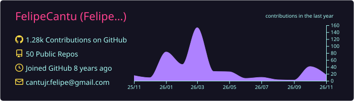
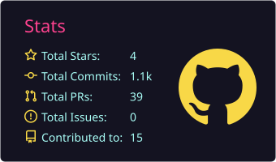
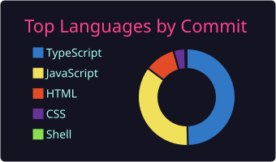

# Hey, I'm Felipe

**Full-stack developer · Next.js, TypeScript & Python · I build things for music, 3D and commerce**

I'm a full-stack developer with a computer-tech background. I like shipping complete products — desktop app, API, web player, payments, deploy — not just the frontend. Outside of code I make music and teach JavaScript, which is why a lot of what I build ends up being for musicians.

- Building **[DiZC](https://github.com/FelipeCantu/GhostAudio)**, a hi-fi music library for people who own their collection
- **Open to full-time roles** — full-stack or frontend-leaning
- Taking freelance web projects on [Fiverr](https://www.fiverr.com/felipecantu)
- Best way to reach me: [LinkedIn](https://www.linkedin.com/in/felipe-cantu-jr/)

---

## Featured projects

### [DiZC](https://github.com/FelipeCantu/GhostAudio) — hi-fi music library · [web player](https://dizc.vercel.app) · [Windows download](https://github.com/FelipeCantu/GhostAudio/releases)
One-click CD ripping with automatic MusicBrainz metadata, FLAC/ALAC/WAV import, cloud streaming from Cloudflare R2, smart playlists, and a mobile PWA — one account across desktop, web and phone.
`Electron` `Next.js 16` `React 19` `TypeScript` `Django REST` `MongoDB` `Cloudflare R2` `ffmpeg`

### [Quantum Gameware](https://github.com/FelipeCantu/Quantum-Gameware) — e-commerce store for gaming gear · [live](https://quantum-gameware.vercel.app)
Gaming-gear storefront with a Sanity-managed catalog, Stripe checkout, accounts, cart and wishlist, plus a built-in AI shopping assistant.
`Next.js` `TypeScript` `Stripe` `Sanity` `MongoDB` `Three.js`

### [Anakupto](https://github.com/FelipeCantu/Anakupto) — 3D web experience · [live](https://anakupto.vercel.app/)
Studio site for building 3D websites: WebGL hero, post-processing, smooth scroll, and a contact drawer wired to email.
`Next.js` `React Three Fiber` `Framer Motion` `Firebase` `Resend`

### [New Meridian](https://github.com/FelipeCantu/New-Meridian) — band website
Scroll-driven 3D site for a progressive post-hardcore band — the whole page is one WebGL scene you descend through.
`Next.js` `Three.js`

---

## What I work with

| | |
|---|---|
| **Frontend** | Next.js · React · TypeScript · Tailwind CSS · Three.js / React Three Fiber · Framer Motion |
| **Backend** | Node.js · Python / Django REST · Electron |
| **Data** | MongoDB · PostgreSQL · Supabase · MySQL · Sanity CMS |
| **Payments & infra** | Stripe · PayPal · Vercel · Railway · Cloudflare R2 · Linux · Git |

---

 

